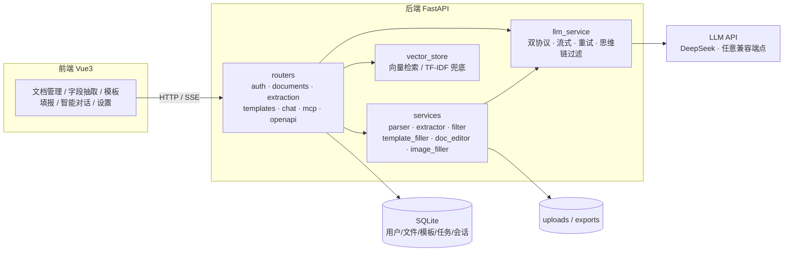

# DocFusion · 文档理解与多源数据融合系统

把一堆格式各异、口径不一的原始材料（统计公报、监测数据、Excel 台账），变成一张填好的申报表。

DocFusion 面向「**多源文档 → 结构化指标 → 模板填报**」这一条真实业务链路：解析 docx / doc / xlsx / xls / md / txt，
抽取指标，按列名语义对齐到模板，最后把结果写回**保留原有样式**的 Word / Excel 模板；全程可用自然语言驱动。

- 后端：FastAPI + SQLAlchemy + SQLite
- 前端：Vue 3 + Vite + TypeScript + Element Plus + ECharts
- 模型：任意 Anthropic / OpenAI 兼容接口（默认 DeepSeek）

---

## 〇、团队信息

| 项 | 内容 |
|---|---|
| 团队名称 | Blossoms pave your way |
| 参赛者 | 郑铭创、叶子豪、刘沛嫣 |
| 学校 | 广州软件学院 |
| 组别 | B 组（非 985/211 普通本科院校本科生） |
| 指导教师 | 喻晓雨、翟玲玲 |
| 参赛赛事 | 2026 第九届传智杯 · 全国高校 AI Web 开发挑战赛 |
| 赛题方向 | 方向 4：AI 协同办公工具 —— 智能文档分析平台 |
| 参赛材料 | [Releases · v1.0.0](https://github.com/zhengmingchuang/blossoms/releases/tag/v1.0.0) —— 技术文档 / 概要介绍 / 详细方案 / 简介 PPT 可直接下载 |

分工：郑铭创（后端架构、抽取与填表链路）、叶子豪（前端交互与可视化）、刘沛嫣（数据处理、测试与文档）。

---

## 一、核心能力

| 模块 | 能力 | 实现位置 |
|---|---|---|
| 文档解析 | docx/doc/xlsx/xls/md/txt 统一切块，xlsx 表头智能识别，.doc 经 LibreOffice 转换 | `services/document_parser.py`、`services/legacy_doc.py` |
| 字段抽取 | 规则抽取 + LLM 抽取混合（`hybrid_extract`），叙事型文本也能定位数值 | `services/extractor.py` |
| 语义检索 | sentence-transformers 向量检索，缺依赖时自动降级 TF-IDF + jieba 分词 | `services/vector_store.py` |
| 模板识别 | 自动判定 `table_fill`（表头批量填）/ `field_fill`（字段填空），支持 docx 多表 | `services/template_filler.py` |
| 表格填报 | 列名语义映射、脏数据清洗、伪合计行剔除、行政区后缀归一化、求和/极值/均值列 | `routers/templates.py`、`services/smart_fill.py` |
| 图片填充 | Excel 图片占位符：WPS `DISPIMG` 单元格图片 + openpyxl 浮动图片 | `services/image_filler.py` |
| 文档编辑 | 12 个 Agent 工具（改文档 / 排版 / 建表 / 加图表 / 校验表格 / 智能填表），自然语言驱动 | `services/doc_editor.py` |
| 智能对话 | SSE 流式输出、工具调用步骤实时回显、可中断 | `routers/chat.py` |
| MCP 服务 | 13 个工具经 MCP 协议对外暴露（HTTP + SSE / JSON-RPC） | `services/mcp_service.py` |
| 开放接口 | `/api/openapi/*` 供外部系统调用抽取能力 | `routers/openapi.py` |

---

## 二、架构



设计上的三个取舍：

1. **样式保真优先**：填表不重建文档，而是复制模板文件后只写单元格 / 段落值，合并单元格、字体、列宽、图片一律不动。
2. **模型可插拔**：`llm_service` 同时实现 Anthropic 与 OpenAI 两种协议，切换供应商只改配置，不改代码；`LLM_DISABLE_THINKING` 默认关闭思考模式，避免 `temperature=0` 失效与多轮工具调用 400。
3. **LLM 只做它擅长的事**：数值清洗、去重、合计行剔除、单位归一化全走规则，LLM 只负责语义映射与自然语言抽取，成本与稳定性都可控。

---

## 三、目录结构

```
Blossoms/
├── backend/
│   ├── main.py                 # 入口：建表、迁移、加载配置、托管前端产物
│   ├── config.py               # 环境变量与运行时配置
│   ├── models.py               # ORM 模型
│   ├── routers/                # 10 个路由模块
│   ├── services/               # 12 个业务服务
│   ├── requirements.txt
│   └── .env.example
├── frontend/
│   ├── src/main.ts             # 入口：挂载应用、注册 Element Plus 与图标
│   ├── src/api/index.ts        # 接口层（含 SSE 流式解析），响应体全部有类型
│   ├── src/api/types.ts        # 与后端 models.py 对齐的 DTO 定义
│   ├── src/router/index.ts     # 路由表，页面级懒加载
│   ├── src/views/              # 7 个页面
│   ├── eslint.config.js        # ESLint 扁平配置（JS + TS + Vue）
│   ├── .prettierrc.json        # 代码风格
│   ├── tsconfig.json
│   └── vite.config.js          # dev 代理 → 127.0.0.1:8000，生产分包策略
├── samples/                    # 演示样例包（合成数据，见下）
├── scripts/
│   ├── verify_llm.py           # 模型通道健康检查（换模型必跑）
│   ├── ab_compare.py           # 抽取层 A/B 对比脚手架
│   ├── faithfulness_check.py   # 忠实度交叉校验（回查源文档原文）
│   ├── make_samples.py         # 生成 samples/ 样例包
│   └── start_dev.ps1           # Windows 一键启动
├── ab_report/                  # A/B 实测数据与结论
└── docs/                       # 技术文档、申报材料清单
```

---

## 四、快速开始

### 环境要求

| 依赖 | 版本 | 说明 |
|---|---|---|
| Python | 3.11+（实测 3.13） | 后端 |
| Node.js | 18+（实测 22） | 前端 |
| LibreOffice | 可选 | 仅解析旧版 `.doc` 需要，缺失时该格式会报错，其余格式不受影响 |

### 1. 后端

```bash
cd backend
python -m venv .venv
# Windows
.venv\Scripts\activate
# macOS / Linux
source .venv/bin/activate

pip install -r requirements.txt
cp .env.example .env      # 然后填入 LLM_API_KEY
python main.py            # 默认 http://127.0.0.1:8000
```

首次启动会自动建表、创建管理员 **admin / admin123**（请自行修改）。

> `requirements.txt` **默认不含** `sentence-transformers`（它会连带安装 PyTorch，约 2 GB）。
> 不装也能跑通全部主流程——`services/vector_store.py` 捕获 ImportError 后自动降级为 TF-IDF 检索。
> 需要更好的召回效果时再单独安装：`pip install -r requirements-optional.txt`。

### 2. 前端（开发模式）

```bash
cd frontend
npm install
npm run dev               # http://127.0.0.1:3000，/api 代理到 8000
```

代码质量检查（提交前跑一遍，三项全绿才算干净）：

```bash
npm run verify            # = typecheck + lint
npm run format            # Prettier 统一格式
```

| 脚本 | 作用 |
|---|---|
| `npm run typecheck` | `vue-tsc --noEmit`，含 `.vue` 的模板类型检查 |
| `npm run lint` | ESLint（`@eslint/js` + `typescript-eslint` + `eslint-plugin-vue`） |
| `npm run format` | Prettier 格式化，规则见 `.prettierrc.json` |
| `npm run verify` | 上面两项串联，CI 可用 |

### 3. 单端口运行（演示 / 部署推荐）

```bash
cd frontend && npm run build     # 产物输出到 frontend/dist
cd ../backend && python main.py  # 直接访问 http://127.0.0.1:8000
```

后端检测到 `frontend/dist/index.html` 会自动托管静态资源，并对非 `/api` 路径回落 `index.html`
（兼容前端 history 路由），因此**不需要额外配 Nginx**，一个端口就能演示完整应用。

端口默认 8000，云托管时读取环境变量 `PORT`（绑定 `0.0.0.0`）：

```bash
PORT=8080 python main.py    # 容器 / 云平台注入 PORT 时无需改代码
```

---

## 五、模型配置（最容易踩的坑）

配置有两个来源，**数据库会覆盖 `.env`**：

```
.env  →  config.py  →  main.py::load_saved_config()  ←  system_config 表（优先级更高）
```

启动日志会打印实际生效值与来源：

```
LLM 生效配置: format=anthropic base=https://api.deepseek.com/anthropic
             model=deepseek-flash key=已设置 来源=数据库覆盖 llm_model
```

**换供应商的正确姿势**（三步，缺一不可）：

1. 改 `backend/.env` 的 `LLM_API_BASE / LLM_API_KEY / LLM_MODEL / LLM_API_FORMAT`
2. 登录系统 → 设置 → 模型配置，把同样的值**再保存一次**（这一步写的是数据库）
3. 跑一遍健康检查：

```bash
python scripts/verify_llm.py            # 8 项全过才算改完
python scripts/verify_llm.py --no-image # 模型不支持视觉时跳过图片项
```

覆盖的 8 条路径：非流式文本 / tools / 多轮 tool_result、流式文本 / tools / 多轮 tool_result、JSON 结构化抽取、图片理解。

关于 `LLM_DISABLE_THINKING`（默认 `true`）：DeepSeek V4 默认开启思考模式，会导致
`temperature` 被忽略、延迟与成本翻倍、带 tools 的多轮请求因未回传 `reasoning_content` 直接 400。
回滚到 Anthropic 官方 API 时需改为 `false`（官方 `thinking.type` 不接受 `disabled`）。

---

## 六、样例数据演示（约 3 分钟）

`samples/` 是一套**合成数据**（城市名与数值均为虚构），用于在不接触真实业务数据的前提下跑通全链路：

```
samples/source/2025年临江市国民经济和社会发展统计公报（节选）.docx   # 叙事型，考验 LLM 抽取
samples/source/2025年三市主要经济指标.xlsx                          # 结构化，走规则映射
samples/template/区域经济运行情况申报表.docx                          # docx 模板
samples/template/区域经济指标汇总表.xlsx                              # xlsx 模板
samples/expected/期望结果.md                                        # 15 个数据格的期望值
```

操作路径：登录 → 文档管理上传两份源文件 → 模板填报上传 xlsx 模板并选择数据源 → 下载结果比对期望值。

**基线结果**（2026-10-31 实测，DeepSeek）：两种模板各 3 行 × 5 列 = 15 格**全部正确**，
`accuracy=1.0`，单次填报约 2.5 秒。重新生成样例：`python scripts/make_samples.py --force`。

---

## 七、效果与实验

抽取层 A/B 实测（100 行 × 5 列 = 400 个数据格，源文档为叙事型 docx，完整报告见 `ab_report/final_report.md`）：

| 指标 | DeepSeek | 基准（历史 Claude 产物） |
|---|---|---|
| 实体覆盖 | 100%（100/100） | 100% |
| 逐格准确 | 99.75%（399/400） | — |
| 列名合规 | 100% | 100% |
| 忠实度（数值可在原文找到） | **100%（400/400）** | 99.75% |
| 耗时 | 5.7s（5 批并发） | — |
| 成本 | 约 0.035 元/次 | 高一个量级 |

唯一分歧是苏州 GDP：源文原文 27,695.10 亿元，DeepSeek 输出 27695.1（正确），
基准为 27027.1（错误）。修正后 DeepSeek 实际准确率为 **400/400**。

为防止「两侧同时抽错」，另有 `scripts/faithfulness_check.py`：绕过基准，直接把模型输出的每个数值
回查源文档原文，用原文命中率衡量是否编造。

---

## 八、前端工程化

这一节单独列出来，是因为本赛项「作品须以前端 Web 应用为主要呈现形态」——前端不是壳，是交付物本身。

**类型分层**：`src/api/types.ts` 把后端 DTO 集中定义一次，`src/api/index.ts` 里每个方法都带泛型返回值。
调用方拿到的是 `AxiosResponse<DocumentListResult>`，字段写错在编辑器里就报红，不用等运行。

**规范与检查**：

| 手段 | 配置 | 现状 |
|---|---|---|
| TypeScript | `tsconfig.json`（`strict` + `verbatimModuleSyntax`） | `main` / `api` / `router` 已迁移；`vue-tsc --noEmit` 零错误 |
| ESLint | `eslint.config.js`（扁平配置，JS + TS + Vue 三套规则叠加） | 零 error 零 warning |
| Prettier | `.prettierrc.json`（无分号 / 单引号 / 110 列） | 全仓 `--check` 通过 |
| 编辑器一致性 | `.editorconfig` 风格由 Prettier 统一 | — |

**性能**：

- 路由级懒加载：7 个页面全部 `() => import()`，首屏只加载登录页。
- vendor 分包：`vite.config.js` 里按 `element-plus` / `echarts` / `vue` 拆成三个 chunk，
  业务代码发版时 vendor 的 hash 不变，可继续命中强缓存。
- 构建结果：入口 chunk 4.4 kB（gzip 2.0 kB），最大页面 chunk 23.6 kB（gzip 8.1 kB）。

**AI 交互**：`chatApi.askStream` 用 `fetch` + `ReadableStream` 手写 SSE 解析（`EventSource` 不支持
POST 与自定义头），按空行切分事件、容忍网络半包，逐 token 渲染；`AbortController` 支持中途停止。

---

## 九、常见问题

| 现象 | 原因 / 处理 |
|---|---|
| 改完 `.env` 模型没变 | 数据库 `system_config` 覆盖了它，去设置页再保存一次 |
| 启动报 `address already in use` | 8000 被占用（常见于上次没退干净），换端口或结束旧进程 |
| 前端 3000 端口接口全 404 | 后端没起，或后端端口不是 8000；可用 `VITE_API_TARGET` 指定 |
| `.doc` 解析失败 | 未安装 LibreOffice，跑 `scripts/install_libreoffice.ps1` |
| 首次对话很慢 | 嵌入模型在下载；或模型未关闭思考模式 |
| 会话里出现别人的历史消息 | 已修（开启 SQLite 外键 + 删会话时级联删消息），旧库需清理孤儿数据 |

---

## 十、已知限制

- 单机 SQLite，未做并发压测；多用户高频写入场景需换 PostgreSQL。
- 内测阶段所有账号被统一提升为 `admin`（`main.py` 内显式标注），正式使用需按角色收口。
- `CORS` 目前放开为 `*`，公网部署前应改为白名单。
- 旧版 `.doc`、扫描版 PDF（需 OCR）不在支持范围内。
- 模板识别基于表头文本与结构启发式，极端非标准模板仍可能需要人工指定映射。
- 前端为**渐进式 TypeScript**：`main` / `api` / `router` 已迁移，`views` 与 `components` 仍是
  `.vue` 内的 JS（`checkJs: false`），后续按页面逐个补类型。

---

## 十一、开发辅助脚本

| 脚本 | 用途 |
|---|---|
| `scripts/verify_llm.py` | 8 条模型调用路径健康检查，换模型/换供应商后必跑 |
| `scripts/ab_compare.py` | 两套模型配置在同一用例上的抽取结果对比，输出 md/json 报告 |
| `scripts/faithfulness_check.py` | 忠实度交叉校验，检测数值编造 |
| `scripts/make_samples.py` | 生成/刷新 `samples/` 演示样例包 |
| `scripts/start_dev.ps1` | Windows 一键：建 venv、装依赖、起后端 |

---

## 许可证

MIT，见 [LICENSE](LICENSE)。

Copyright (c) 2026 郑铭创、叶子豪、刘沛嫣（广州软件学院 · Blossoms pave your way 团队）
