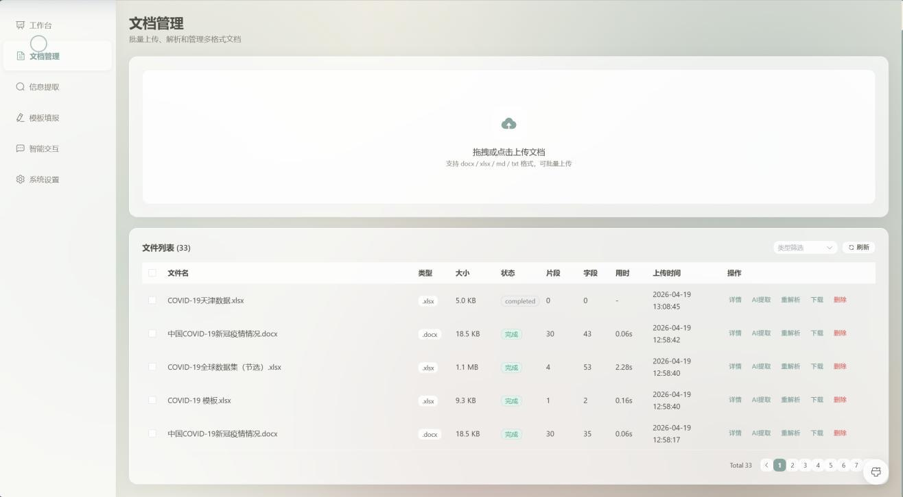
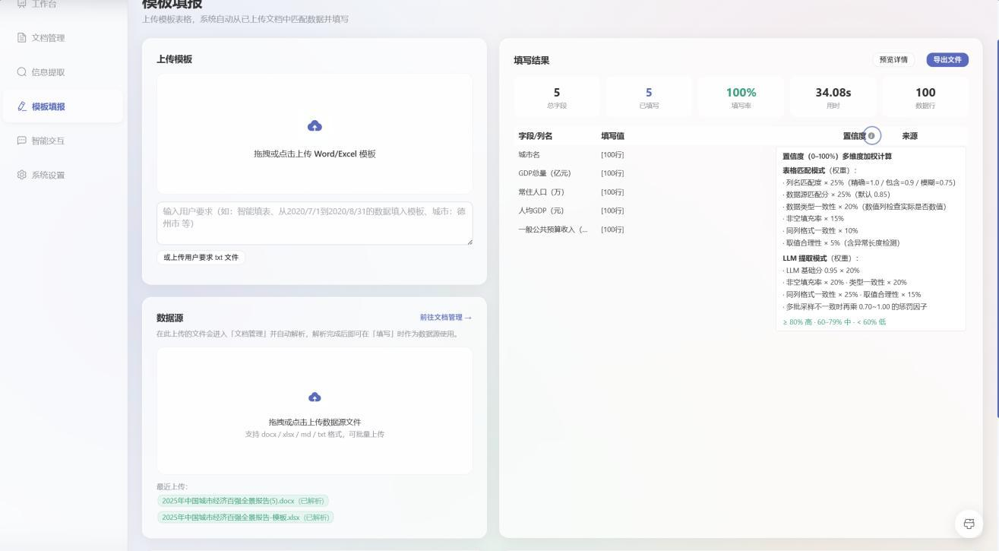
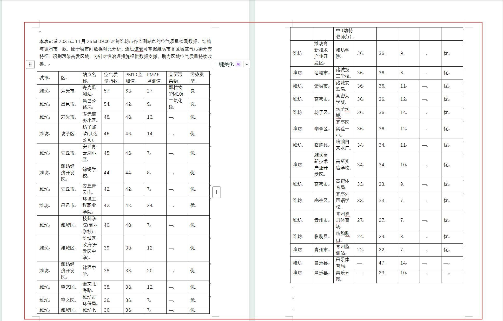
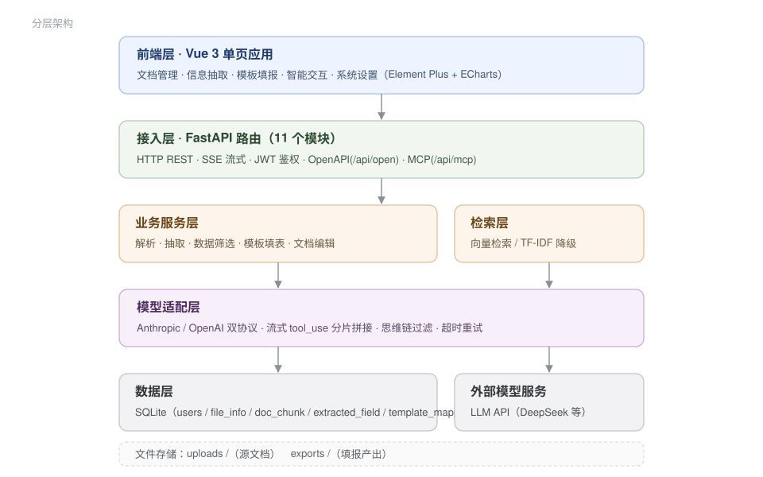
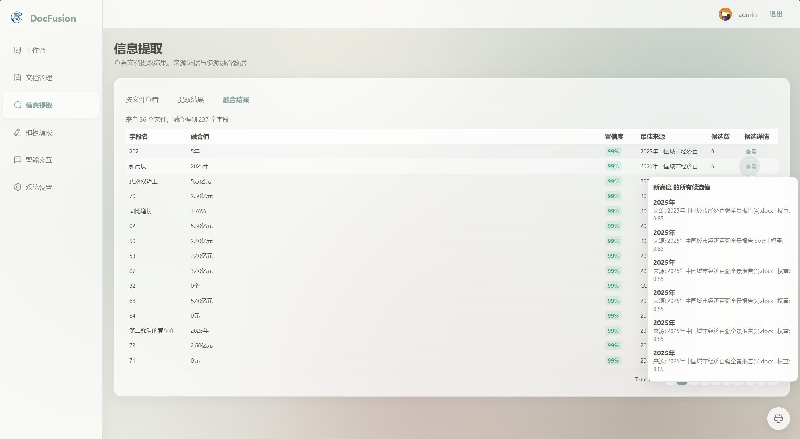
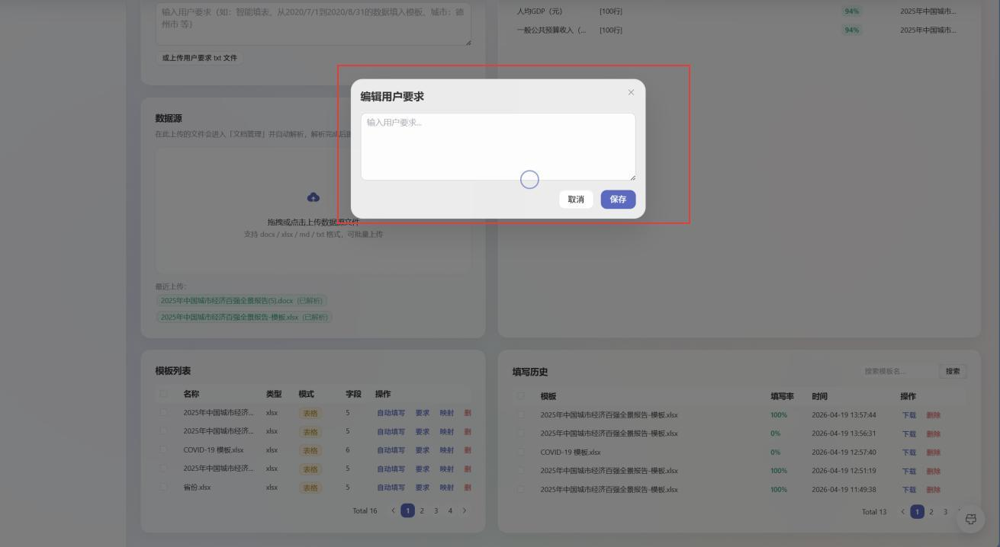
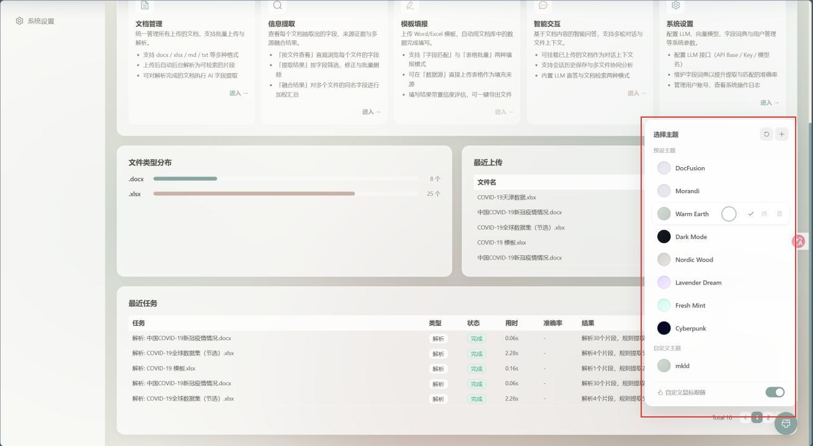

# 作品介绍文档

**DocFusion · 基于大语言模型的多源文档理解与填报平台**

2026 第九届传智杯 · 全国高校 AI Web 开发挑战赛 · 方向 4「AI 协同办公工具」· B 组

广州软件学院 · 叶韵铭心团队 · 郑铭创 / 叶子豪 / 刘沛嫣 · 指导教师 喻晓雨、翟玲玲

在线仓库：https://github.com/zhengmingchuang/blossoms

<div class="page-break"></div>

## 一、项目详情及使用方式

### 1.1 项目要解决的问题

基层单位每月要填几十张报表：数据散在统计公报的段落里、散在十几个 Excel 台账里、散在往年 PDF 里，
口径还不一致——同一件事在 A 表叫「一般公共预算收入」，在 B 表叫「公共财政预算收入」。
人工做法是「打开原文 → 肉眼找数 → 复制粘贴 → 手调格式」，一张 100 行的表要半天，且极容易抄错行。

DocFusion 不生成新表格，而是**在原模板上定点写入**：把模板文件复制一份，只把数值填进对应单元格，
合并单元格、字体、列宽、页眉页脚、图片一律不动。产出物可以直接报送，不需要二次排版。

一句话：**把「找数、核对、抄写」交给系统，把「判断、签字」留给人。**

### 1.2 完整使用流程

系统提供 Web 界面、对话 Agent、API/MCP 三种入口，核心链路一致：**接入 → 抽取 → 填报 → 核验 → 导出**。

**第一步：上传源材料。** 支持 docx / doc / xlsx / xls / pdf / md / txt / 图片，
统一解析切块入库；xlsx 自动识别真实表头行（跳过标题行和合并表头）。

**第二步：结构化抽取。** 规则先走一遍（表格直接读、千分位与单位归一化），
叙述型文本交给大模型抽取，两者结果融合投票。抽取结果在「信息抽取」页可逐字段查看、就地修改。

**第三步：选择模板并填报。** 上传模板后系统自动判定模式：
表头批量填（table_fill）或字段填空（field_fill），docx 多表模板可逐表分别映射。
用户可以用自然语言给约束，例如「只填 GDP 超过 5000 亿的城市」「按 GDP 降序取前 20」「日期从 2020/7/1 到 2020/8/31」。

**第四步：核验与导出。** 每个填进去的数值都能反查源文位置；条件没落地、某列没数据、
表头单位有歧义，都会在结果页显式告警而不是静默通过。确认后下载成品文件。



图 1-1 文档管理：多格式上传、批量解析与状态跟踪



图 1-2 模板填报：上传模板、勾选数据源、用自然语言描述填报要求



图 1-3 填报结果：逐格回填、样式保真，可下载原格式成品

### 1.3 部署与运行

三步即可跑起来，单端口托管，不需要额外配置 Nginx：

```bash
# 1. 后端
cd backend
python -m venv .venv && .venv\Scripts\activate     # macOS/Linux: source .venv/bin/activate
pip install -r requirements.txt
cp .env.example .env        # 填入 LLM_API_KEY
python main.py              # http://127.0.0.1:8000

# 2. 前端（开发模式，可选）
cd frontend && npm install && npm run dev          # http://127.0.0.1:3000

# 3. 生产模式：构建后由后端一并托管
cd frontend && npm run build && cd ../backend && python main.py
```

首次启动自动建表并创建管理员账号，初始口令随机生成并写入 `backend/.admin_initial_password`，
不落明文配置。云托管时后端读取 `PORT` 环境变量，无需改代码。

**环境要求**：Python 3.11+、Node.js 18+；LibreOffice 可选（仅解析旧版 `.doc` 需要）。
`requirements.txt` 默认不含 `sentence-transformers`（会连带安装约 2 GB 的 PyTorch），
未安装时检索自动降级为 TF-IDF + jieba 分词，主流程不受影响。

### 1.4 三种使用入口

| 入口 | 适合谁 | 说明 |
|---|---|---|
| Web 界面 | 业务人员 | 上传 → 填报 → 下载，全程点选，无需懂提示词 |
| 对话 Agent | 需要组合操作的人 | 「把这份报表按 GDP 排序，再导出一份摘要 Word」，13 个工具多轮调用，步骤实时可见 |
| API / MCP | 开发者、其它智能体 | 9 个 X-API-Key 开放端点；13 个工具经 MCP 协议暴露，可被 Claude Desktop、Cursor 等直接调用 |


图 1-4 智能对话：多轮工具调用，每步的执行细节与结果都可见

<div class="page-break"></div>

## 二、项目亮点

### 亮点一：填表是「写进原文件」，不是「重新生成」

绝大多数文档 AI 的产出是新文件，格式靠 prompt 描述，出来的东西样式总是差一点。
本项目把模板当容器：解析模板的单元格坐标与样式，复制原文件后只改值。

好处是排版零损耗——合并单元格、行高列宽、字体、边框、页眉页脚、内嵌图片全部保留，
填报结果可以直接报送。代价是要处理大量边界情况：合并单元格跨行、伪合计行、
公式单元格、图片占位符（WPS `DISPIMG` 与浮动图片两套机制），这些都已覆盖。

### 亮点二：条件解析走「规则 + 大模型」双路，各做各擅长的事

用户说「GDP 超过 5 万亿」，规则能精确识别，零成本、可解释；
用户说「达到五万亿」「别低于五万亿」，规则认不出，交给模型理解。
**规则优先，规则落不了地才问模型**，并且结果页标注「该条件由模型解析，请核对」。

为什么不全交给模型：阈值会幻觉，`5 万亿` 被理解成 `5` 的案例在测试里真实出现过。
为什么不全用规则：句式是穷举不完的，改一处措辞就漏一处，且漏了不会报错。
两路互补，才既准又全。

### 亮点三：选数据源这一步交给模型，但读数绝不交给模型

同名数据源（`2025年城市数据.xlsx` 与 `2024年城市数据.xlsx`）列名完全一致时，
规则靠列名相似度会打平甚至选错年份。系统的处理是：**只在「选哪个文件」这一步让模型决策，
具体数值仍然走结构化读取**。模型返回异常（0、越界、非数字、超时）一律回退规则结果。

这样既用上了模型对「用户到底要哪一年」的理解，又不会让模型有机会编造数值。

### 亮点四：每个数值都能反查源文

填完之后，系统对每个数值做一次溯源：这个数字是否真的出现在源文档里？
定位不到就标出来。这一层是防「看起来正常、实际编造」的最后一道闸门。

在 100 行 × 5 列 = 400 格的实测中，忠实度 100%（400/400），
并且用这套机制发现**对照基准本身有一个错误**（苏州 GDP 27,695.10 被旧产物写成 27,027.1）。

### 亮点五：宁可报错，不静默出错

填表类系统最危险的失败不是崩溃，是「返回一张看起来正常、实际全错的表」。项目对这类情况一律显式处理：

| 情况 | 处理方式 |
|---|---|
| 筛选条件落不到任何列 | 显式告警，不按「未筛选」返回全表 |
| 筛选后 0 行 | 按「年份 → 精确匹配」逐级放宽并告警；放宽到底仍 0 行则拒绝出表（422） |
| 模板要的字段在数据源里完全没有 | 拒绝填充，点名缺哪些列，提示「数据源可能选错了」 |
| 表头声明单位但源值未标单位 | 列出受影响行数与样例值，让用户选口径，不擅自猜 |
| 数值条件被解析成阈值但列头单位不同 | 按表头单位换算后标注，换算依据可见 |

### 亮点六：安全边界按「会被攻击」设计

文档处理系统天然要解开别人给的压缩包，这是最容易被忽视的攻击面：

- **解压炸弹闸门**：条目数、解压后总体积、单条目体积、压缩比四道阈值，接在所有上传口
- **XXE**：`python-docx` / `openpyxl` 显式关闭外部实体解析，lxml 兜底分支强制安全解析器
- **越权**：所有文件操作按 `user_id` 隔离，跨用户访问返回 404/403
- **提示词注入**：文件名、列名、工作表名视为数据而非指令，去控制字符并截断后再生效

<div class="page-break"></div>

## 三、AI 测试技术落地使用情况概述

大模型应用的效果不能靠「看起来对」来判断。本项目建立了四层测试体系，**每一层都能独立复现**，
且全部随仓库发布（`scripts/` 目录，口令从环境变量读取）。

### 3.1 四层测试体系

| 层级 | 脚本 | 覆盖什么 | 结果 |
|---|---|---|---|
| 结构化回归 | `fill_regression.py` | 填表全链路：上传源 → 上传模板 → 填报 → 下载 → 逐格比对期望值 | xlsx 12/12、docx 12/12，accuracy 均 **1.0** |
| 大模型基准 | `llm_fill_bench.py` | 8 类典型难点：千分位与单位、同义列名、质量标记、缺值不编、中文数字、多句合并、表头无单位、百分比干扰 | 8/8 用例、逐格 **18/18 = 100%** |
| 对抗测试 | `adversarial_*.py`（11 个） | 接地判定、多表模板、解析截断、越权、提示词注入、重复文件、错配数据源、无数据源 | 接地 11/11、多表 24/24、解析截断 5/5、填表 6/6、其余全过 |
| 真实测试集 | `demo_testset_eval.py` + `demo_testset_score.py` | 三套第三方数据（山东空气质量、城市百强、COVID-19）逐格核对 | A 474/474、B 400/400、C 7626 + 2542 + 112，**全部 100%** |

### 3.2 关键量化结果

**（1）抽取层模型 A/B 实测**（`ab_report/final_report.md`，100 行 × 5 列 = 400 格，
源文档为叙事型 docx，必须从自然语言段落里抽数）：

| 指标 | 结果 |
|---|---|
| 实体覆盖率 | 100.0%（100/100，0 缺失、0 多余、0 重复） |
| 逐格准确率 | 99.75%（399/400），唯一分歧经核实为基准错误，修正后 **100%** |
| 列名合规率 | 100.0%（JSON key 与模板列名逐字一致） |
| 忠实度（防编造） | 100.0%（400/400 数值均可在源文定位） |
| 耗时 / 成本 | 5.7 秒（5 批并发）/ 约 **0.035 元/次** |

**（2）三套真实测试集逐格核对**：

| 用例 | 规模 | 逐格结果 | 召回 |
|---|---|---|---|
| A 山东空气质量 | 79 个城市站点 | 474/474 = 100% | 79/79 = 100% |
| B 城市百强 | 100 个城市 × 5 列 | 400/400 = 100% | 100/100 = 100% |
| C COVID-19 | 2570 行 | 7626/7626 + 2542/2542 + 112/112 | 41/41 国家、2542/2542 明细行 |

评分脚本不读系统自报的准确率，而是**从源文件独立重算**——自报数字不可信，这是评估的基本原则。

### 3.3 用阳性对照证明「改进真的有用」

只看到「改完之后通过了」，无法排除「本来就会通过」。所以关键改动都配了对照组：

| 改动 | 对照结果 |
|---|---|
| 大表索引改为按字符预算分批 | 旧实现（固定 40 行 + 硬截断）在 2000 行数据上**只存活 449 行**，新实现 2000/2000 一行不丢 |
| 列名接地只按量列计算 | 全列口径会把「城市」判成无据（ratio 0.67）并清空整列实体名；量列口径 ratio 1.0，不误伤 |
| 选源仲裁开关 | 关闭仲裁选错年份（FAIL）；开启后选对（PASS），同一测试集、唯一变量是开关 |
| 解压炸弹闸门 | 同一内存上限下，未设防时炸弹包可撑爆进程，设防后被拦在解压前 |

### 3.4 测试暴露并修掉的真实缺陷

测试的价值不在「全绿」，在能抓到东西。本轮通过测试发现并修复的代表性问题：

1. **大表索引静默丢行**：固定 40 行一批再硬截断到 1600 字，宽表每行约 280 字，
   实际每批只保留前 5~6 行。2000 行数据只有 449 行进索引，且没有任何提示——
   表现为「问某个国家某天的数据，模型说找不到」。改为按字符预算攒批后彻底解决。
2. **列名接地误伤维度列**：加了防幻觉闸门后，把「城市」列算进分母，
   而源文写「杭州市」不写「城市」，导致整列实体名被清空，8 个 LLM 用例从 8/8 掉到 0/8。
   修正为「只按量列计算接地率」后恢复 100%。
3. **上游额度错误被当成系统故障**：模型返回 402 时系统报 502 并提示「请勾选数据源」，
   误导用户，还会重试 4 批 × 2 轮共 12 次无效调用。改为识别 401/402/403 直接短路，
   并把上游异常翻译成人话。
4. **越权测试从未真正跑起来**：测试脚本自身 bug（注册用 A 口令、登录用 B 口令）导致 401，
   整组「越权」用例一直是假绿。修好脚本后才发现越权防护本身是对的。

<div class="page-break"></div>

## 四、项目涉及的关键技术

### 4.1 系统架构



图 4-1 系统分层架构

前后端分离 + 单端口托管。后端 FastAPI 承担解析、抽取、填报、对话、MCP 五条链路；
前端 Vue 3 + TypeScript，路由级懒加载，vendor 按 vue / element-plus / echarts 分包，
入口 chunk 4.4 kB。

### 4.2 混合抽取管道

规则与大模型并行，结果融合投票：

- **规则侧**：表格直接读单元格；千分位、全角、单位（万/亿/万亿）、百分号归一化；
  中文数字转阿拉伯数字（「五点四万亿」→ 5.4 万亿）；行政区后缀归一（「杭州市」→「杭州」）
- **模型侧**：强制 JSON 输出，解析失败降级为原文回显而非抛错；
  `temperature=0` 保证同输入同输出
- **融合**：多批采样，按实体批次覆盖一致性判断稳定性，冲突时以源文可定位者为准

**质量标记原样保留**：源数据里的 `(H)`、`(PF)`、`*` 等标记不抹成纯数字——
抹掉会把「异常读数」伪装成正常值，这是数据完整性问题。

### 4.3 条件解析：规则与模型的双路合并

```
用户要求 ──► 规则解析（精确句式、数值比较、日期区间、精确匹配、分组）
                │
                ├─ 能落地 ──► 直接用，标注「规则解析」
                │
                └─ 落不了地 ──► 交模型理解 ──► 结果标注「由模型解析，请核对」
```

关键处理：

- 数值条件的关键字先剥离填表动词（「填写GDP」→「GDP」），否则匹配不到列、条件被静默丢弃
- 阈值按表头单位换算：`5 万亿` + 列头「（亿元）」→ 阈值 `50000`
- 但用户只给数字没给数量级时，按列头单位理解，不擅自除以倍率
- 给了数值条件就跳过「补漏填」，否则按模板名推出的预期行数会把筛选结果覆盖成全量

### 4.4 模板定点写入与样式保真

docx 走 python-docx 段落/表格级写入，xlsx 走 openpyxl 单元格写入，
都在「复制出的副本」上操作，原模板文件不动。

难点与处理：

| 难点 | 处理 |
|---|---|
| 合并单元格跨行列 | 按单元格坐标写入，不重建表结构 |
| 伪合计行（源表自带「合计」行） | 识别并剔除，避免把合计当实体 |
| 多表模板 | 逐表独立映射，顶层列是各表列的并集，不能当单表列用 |
| Excel 图片占位符 | 兼容 WPS `DISPIMG` 单元格图片与 openpyxl 浮动图片两套机制 |
| 表头单位与源值单位不一致 | 换算后标注口径，无法判断时交用户确认 |

### 4.5 文档解析与检索

- **格式兼容**：docx / doc（LibreOffice 无头转换）/ xlsx / xls / pdf / md / txt / 图片
- **Strict Open XML**：`conformance="strict"` 的包 openpyxl 会读成零工作表，
  上传时自动就地转换为 Transitional
- **大表索引**：按字符预算分批（攒到接近上限才切批），避免固定行数 + 硬截断导致丢行；
  COVID-19 索引文本从 60 万字提升到 341 万字，一行不丢
- **检索降级**：sentence-transformers 可用时走向量检索，缺失时自动降级 TF-IDF + jieba

### 4.6 Agent 工具与 MCP

对话侧暴露 13 个工具（`search_documents`、`extract_info`、`list_files`、`edit_document`、
`analyze_document`、`format_document`、`create_spreadsheet`、`create_document`、
`format_spreadsheet`、`add_chart`、`validate_spreadsheet`、`fill_template_smart`、
`get_extract_results`），多轮循环直到模型不再请求工具，每轮的工具名、入参、耗时都推给前端。

另有 13 个工具经 MCP 协议对外暴露：JSON-RPC 2.0，`protocolVersion` 2024-11-05，
`POST /api/mcp/jsonrpc` + `GET /api/mcp/sse` 双通道，任何支持 MCP 的客户端都能把本系统当文档工具集调用。

### 4.7 技术栈

| 层 | 选型 |
|---|---|
| 后端 | Python 3.11+ / FastAPI / SQLAlchemy / SQLite |
| 大模型 | 双协议适配（Anthropic Messages + OpenAI Chat Completions），切换供应商只改配置 |
| 检索 | sentence-transformers（可选）/ TF-IDF + jieba 降级 |
| 文档处理 | python-docx / openpyxl / xlrd / PyPDF / Pillow / LibreOffice |
| 前端 | Vue 3 + TypeScript + Vite / Element Plus / ECharts / Pinia |
| 工程化 | ESLint（扁平配置）+ Prettier + vue-tsc，`npm run verify` 全绿 |
| 协议 | REST / SSE / MCP（JSON-RPC 2.0） |

<div class="page-break"></div>

## 五、项目相关照片

以下为系统实际运行界面（真实数据、真实操作，非设计稿）。


图 5-1 仪表盘：文档量、抽取进度、填报任务的实时指标



图 5-2 信息抽取：逐字段查看候选值、置信度与来源，可就地修改



图 5-3 填报要求输入：自然语言描述筛选与排序条件


图 5-4 系统设置：模型、Embedding、MCP 均可热配置，无需重启



图 5-5 主题个性化：8 套主题与自定义编辑器，玻璃拟态界面

<div class="page-break"></div>

## 六、项目之前是否发表过或获奖

**截至本次提交，本项目为团队原创作品，未公开发表论文，未参加其它赛事，无相关获奖记录。**

项目自 2026 年 10 月起在 GitHub 公开迭代（https://github.com/zhengmingchuang/blossoms），
提交历史完整保留，可查看每一次功能演进与问题修复的真实过程。
所有测试脚本、评测报告、量化数据均随仓库发布，结论可复现。

## 七、是否在开源项目基础上优化

**本项目未基于任何开源项目二次开发**，代码为本团队从零编写。

项目**使用**了以下开源库（均在依赖清单中注明，遵循各自许可证）：

| 依赖 | 许可证 | 用途 |
|---|---|---|
| FastAPI / SQLAlchemy | MIT | Web 框架与 ORM |
| python-docx / openpyxl | MIT | Word / Excel 读写 |
| Vue 3 / Element Plus / ECharts | MIT | 前端框架与可视化 |
| sentence-transformers | Apache-2.0 | 向量检索（可选依赖） |
| LibreOffice | MPL-2.0 | 旧版 `.doc` 转换（外部进程，非链接） |

在此基础上，本项目自行设计并实现的、区别于通用框架的部分包括：
模板定点写入与样式保真、规则与大模型双路的条件解析、选源仲裁、
逐格忠实度回查、解压炸弹防护、以及整套可复现的 AI 效果评测体系。
项目自身以 MIT 许可证开源。
