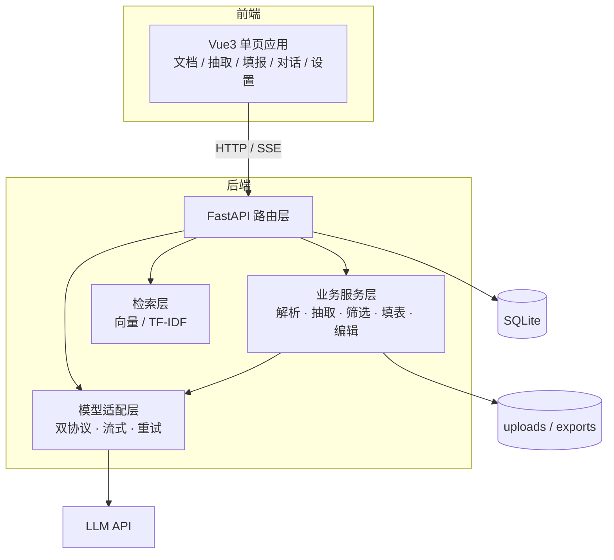
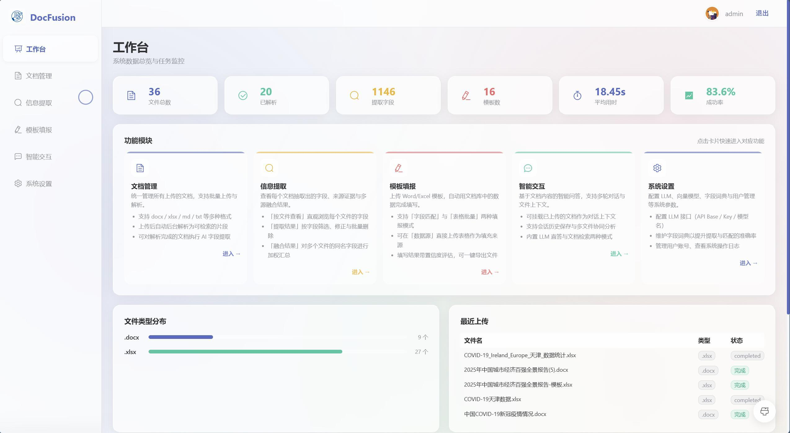
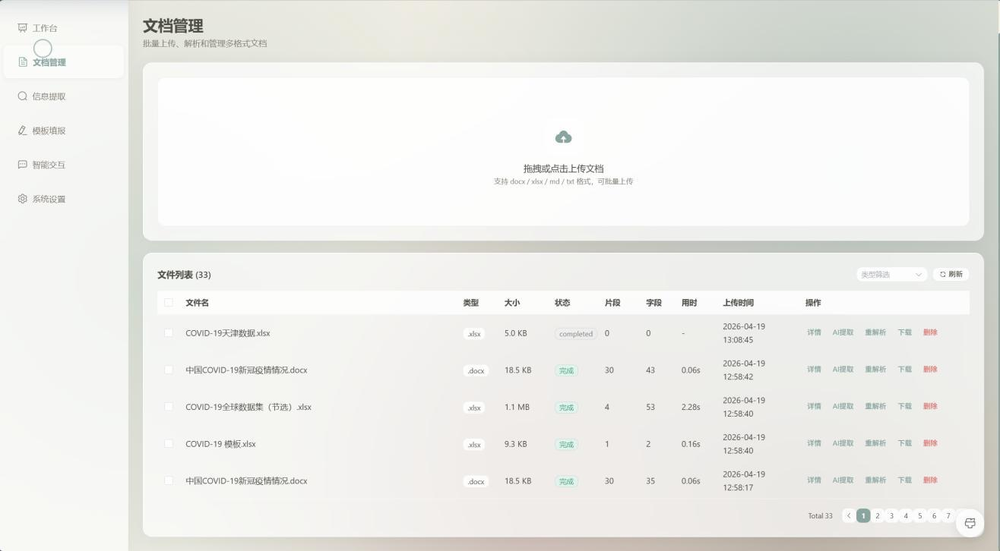
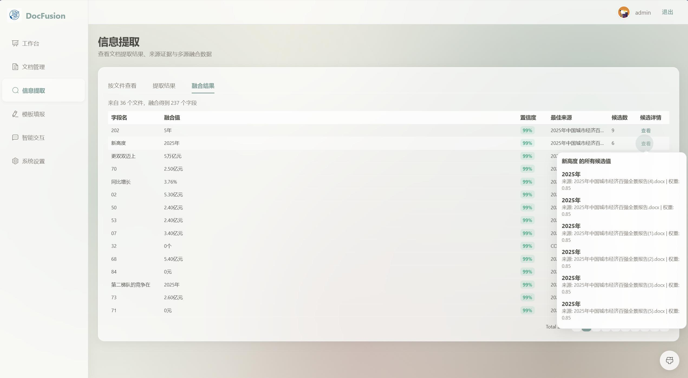
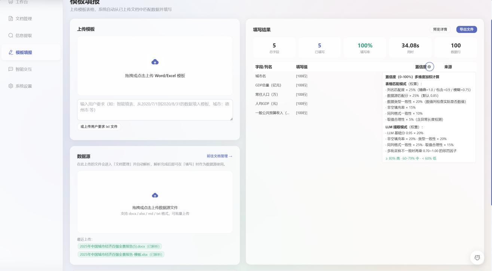
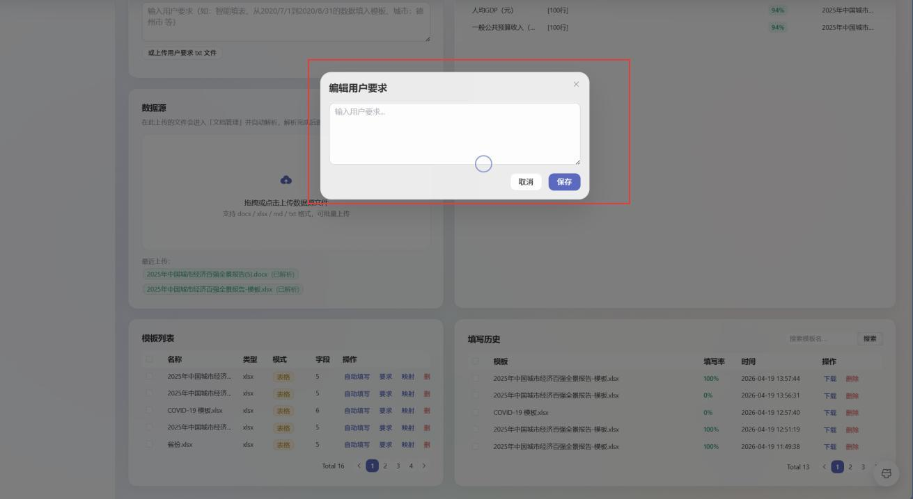
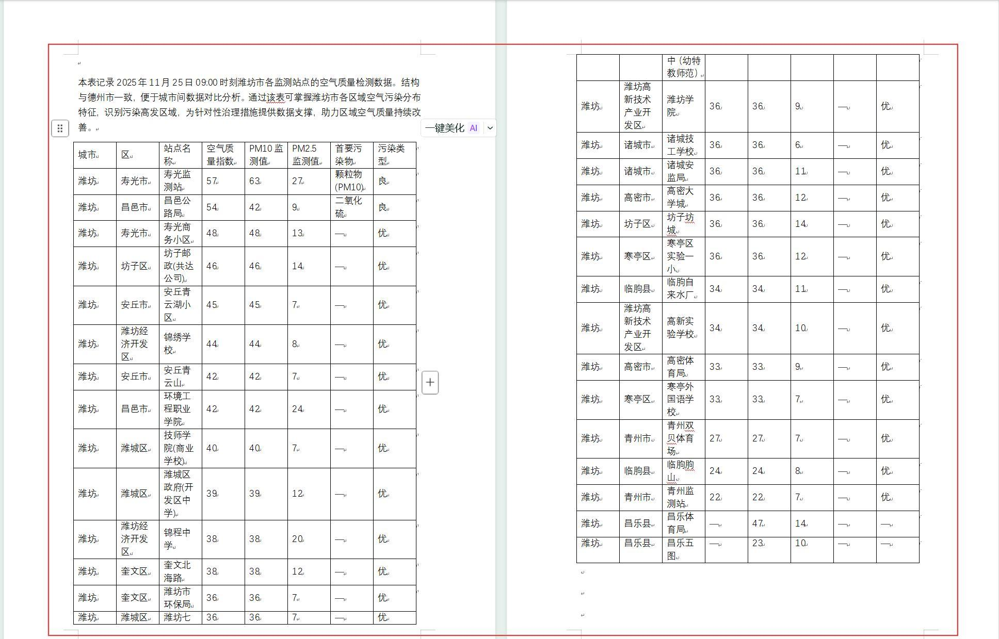
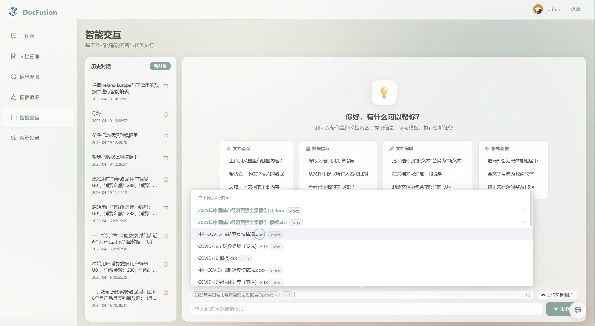
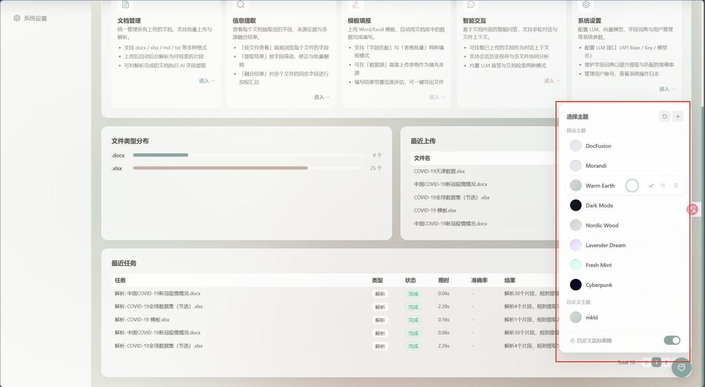

# DocFusion 文档理解与多源数据融合系统

## 技术文档

| 项 | 内容 |
|---|---|
| 作品名称 | DocFusion —— 基于大语言模型的文档理解与多源数据融合系统 |
| 参赛赛事 | 2026 第九届传智杯全国大学生数智创新与 AI 应用大赛 |
| 参赛赛道 | AI 创新应用挑战赛 |
| 参赛者 | 郑铭创、叶子豪、刘沛嫣 |
| 参赛学校 | 广州软件学院 |
| 参赛组别 | 本科 B 组 |
| 指导教师 | 喻晓雨、翟玲玲 |
| 团队名称 | Blossoms pave your way |
| 文档版本 | v1.1 |
| 更新日期 | 2026-11-01 |

> 对应代码版本：`main` 分支（提交历史见公开仓库）
> 演示视频：见 `docs/` 目录同名文件 ｜ 开源仓库：GitHub（见申报材料清单）

---

## 〇、材料索引

| 材料 | 文件 | 说明 |
|---|---|---|
| 技术文档（本文） | `docs/技术文档.md` / `.pdf` | 正文，≤30 页 |
| 项目概要介绍 | `docs/T2605208-…-项目概要介绍.pdf` | 11 页，含图 7 幅 |
| 项目详细方案 | `docs/T2605208-…-项目详细方案.pdf` | 150 页，需求 / 设计 / 测试全量 |
| 项目简介 PPT | `docs/T2605208-…-项目简介PPT.pptx` | 19 页，汇报用 |
| 演示视频 | `docs/T2605208-…-项目演示视频.mp4` | 1920×1038 / 30fps |
| 可复现样例 | `samples/` | 合成数据，15 格期望值 |
| 量化实验报告 | `ab_report/final_report.md` | A/B 400 格 + 忠实度校验 |

---

## 一、项目详情与使用方式

### 1.1 背景与问题

基层单位每年要向上报送大量表格：经济指标汇总、环境监测月报、项目申报书……这些表的数据并不缺，
缺的是「把散落在 Word 报告、Excel 台账、PDF 附件里的数字，准确搬到模板对应格子里」的这一步。
现实做法是人工翻文档、Ctrl+F 找数值、复制粘贴，一份 100 行的汇总表往往要两三个人对一整天，
而且错一个数就要整表返工。

难点集中在三处：

1. **口径不一**：同一个指标在不同文档里叫「GDP」「地区生产总值」「GDP 总量」，单位可能是亿元也可能是万元。
2. **载体不一**：数据有的在表格里，有的埋在「上海以 56,708.71 亿元的 GDP 总量稳居全国第一」这种叙述句里。
3. **模板不能动**：上报模板有合并单元格、有固定字体字号，填完不能破坏格式。

### 1.2 目标用户

- 需要周期性报送统计表的基层统计 / 办公室人员
- 需要从大量材料中汇总指标的项目申报人员
- 需要把非结构化材料转成结构化数据的分析人员

### 1.3 核心功能

| 功能 | 说明 |
|---|---|
| 文档解析 | 支持 docx / doc / xlsx / xls / md / txt，统一切块入库，xlsx 自动识别真实表头行 |
| 字段抽取 | 规则 + LLM 混合抽取，可从叙述型文本中定位指标数值 |
| 模板识别 | 自动判定「表头批量填」与「字段填空」两种模式，docx 支持多表分别映射 |
| 智能填报 | 列名语义映射 → 数据清洗 → 写回模板，保留原样式；支持求和 / 极值 / 均值列 |
| 图片填充 | Excel 图片占位符自动填图（WPS `DISPIMG` 与浮动图片两种方案） |
| 智能对话 | 自然语言驱动 12 个文档工具，流式输出、步骤可见、可中断 |
| MCP 服务 | 13 个工具经 MCP 协议对外提供，可被其他 Agent 复用 |
| 开放接口 | `/api/openapi/*` 供外部系统直接调用抽取能力 |

### 1.4 使用流程

```
登录 → 上传源文档（自动解析切块）
     → 上传模板（自动识别表头/字段）
     → 选择数据源，一键填报
     → 下载结果（原样式） → 对照期望值核验
```

### 1.5 部署方式

- 开发模式：后端 `python main.py`（:8000）+ 前端 `npm run dev`（:3000，Vite 代理 `/api`）
- 单端口模式：`npm run build` 后启动后端，由 FastAPI 托管 `frontend/dist` 并回落 history 路由
- 详细步骤见仓库根目录 `README.md`

---

## 二、项目亮点

### 2.1 样式保真填充，而不是「生成一张新表」

多数同类方案是读模板 → 重建文档 → 写入数据，结果是合并单元格丢失、列宽错乱、印章图片消失。
本项目采用「复制模板文件 + 只写目标单元格」的策略，写入前后除目标单元格外字节级不变，
Word 的表格样式、Excel 的合并区与图片锚点全部保留。

### 2.2 规则与 LLM 的分工边界

LLM 只负责两件它真正擅长的事：**语义映射**（模板列名 ↔ 源文档列名）与**叙述文本抽取**。
数值归一化（千分位、全角、单位换算）、去重、伪合计行剔除、行政区后缀归一化全部走确定性规则。
好处是成本可控（单次填报约 0.035 元）、结果可复现（`temperature=0`）、出错可定位（不是「模型今天心情不好」）。

### 2.3 双协议模型适配层

同一套业务代码可跑在 Anthropic 与 OpenAI 两种协议上，切换供应商只改四个配置项。
这层适配解决了三个真实兼容性坑：流式 tool_use 的 JSON 分片拼接、思维链标签跨包切分、思考模式与 `temperature` 冲突。

### 2.4 可量化的效果验证，而不是「感觉还行」

仓库内置三套验证工具，结论可复现：

- `scripts/verify_llm.py`：8 条模型调用路径健康检查
- `scripts/ab_compare.py`：两套模型配置在同一用例上的逐格对比
- `scripts/faithfulness_check.py`：把模型输出的每个数值回查源文档原文，检测编造

### 2.5 真实工程细节

- SQLite 外键未开启导致的「会话孤儿消息」问题（新会话继承旧消息）已定位并修复
- 上传去重、任务中心、解析进度、失败重试
- 大文件分批（15000 字符 / 批）与并发抽取，5 批并发下 100 行数据 5.7 秒完成

---

## 三、AI 能力应用说明

### 3.1 模型选型

默认 DeepSeek（`deepseek-flash`，Anthropic 兼容端点），理由：

| 维度 | 结论 |
|---|---|
| 抽取准确率 | 400 格中 399 格与基准一致，唯一分歧经核实为基准错误 |
| 忠实度 | 100%（400/400 数值均可在源文档原文找到） |
| 成本 | 约 0.035 元/次（8432 输入 / 6690 输出 token） |
| 兼容性 | 提供 Anthropic 与 OpenAI 两套端点，便于横向对比与降级 |

### 3.2 Prompt 设计（节选，均为仓库真实提示词）

**（1）表格抽取**——约束输出结构，禁止解释性文字：

```
从以下文本中提取结构化数据，列名为：["城市", "GDP(亿元)", "增长率(%)", ...]
每行数据对应一个实体（如省份、国家等），返回JSON数组：[{"列名1":"值1",...}]
只返回JSON数组，不要解释。
```

**（2）字段映射**——明确「找不到就留空」，抑制编造：

```
你是表格填写助手。根据模板字段名，从提供的数据和文档片段中找到对应的值来填写。
规则：
1. 如果字段名是一个指标名（如"GDP"、"常住人口"），找到对应的数值
2. 如果字段名是一个文档/政策/标准/书籍标题，从文档中找到关于它的描述作为值
...
5. 如果文档中完全没有提到该字段，设为空字符串
6. 不要编造数据，不要把字段名本身作为值返回
7. 如果用户要求或字段关系涉及加减乘除，允许基于已提取数据做四则运算
8. 四则运算只能使用已给出的数据，除零或缺失数据时返回空字符串
只返回JSON：{"字段名":"值"}
```

设计要点：把「不许编造」写成**可执行的规则**（第 5、6、8 条），而不是一句「请准确」。
配合 `temperature=0` 与输出侧忠实度校验，形成「提示词约束 + 参数约束 + 事后校验」三重防线。

### 3.3 工作流编排

填报任务的执行链路（`routers/templates.py::_fill_table_mode`）：

```
1. 识别模板结构（表头 / 起始行 / 多表）
2. 解析用户要求 → 规则先解析（城市、时间范围、排序、求和）
3. 选源文件：结构化 xlsx 优先，叙事型 docx 走 LLM 抽取
4. 列名语义映射（LLM + 词向量相似度打分，低分走弱匹配兜底并标「待确认」）
5. 数据清洗：脏值（8659! / 6il3）、伪合计行、行政区后缀、重复行
6. 排序 / 求和 / 极值 / 均值
7. 复制模板写入 → 导出
8. 记录映射明细：字段、来源文件、置信度、是否需人工确认
```

### 3.4 Agent 工具配置

对话侧暴露 12 个工具（`services/doc_editor.py::AGENT_TOOLS`）：
`search_documents`、`extract_info`、`list_files`、`edit_document`、`analyze_document`、
`format_document`、`create_spreadsheet`、`format_spreadsheet`、`add_chart`、`validate_spreadsheet`、
`fill_template_smart`、`get_extract_results`。

工具入参全部使用 JSON Schema 描述，模型侧只拿到 schema，具体执行在本进程内完成，
因此不存在「模型直接操作文件系统」的风险面。

### 3.5 流式输出协议

`POST /api/chat/ask/stream` 采用 SSE，事件序列固定：

```
session  →  delta / tool_start / tool_end  →  done
（异常统一走 error，前端不会挂起）
```

仅在尚未产出任何文本前允许重试，避免已推送内容重复。

### 3.6 降级策略

| 环节 | 主路径 | 降级 |
|---|---|---|
| 向量检索 | sentence-transformers | TF-IDF + jieba 分词 |
| 列名映射 | LLM 语义映射 | 词向量相似度打分 + 弱匹配兜底（置信度封顶 0.65，标记待确认） |
| 模型调用 | 流式 | 非流式；HTTP 502/503/504 与超时自动重试 3 次 |
| `.doc` 解析 | LibreOffice 转换 | 提示安装，不影响其他格式 |

---

## 四、关键技术说明

### 4.1 系统架构



### 4.2 数据模型（核心表）

| 表 | 作用 |
|---|---|
| `users` | 账号、角色、头像 |
| `file_info` | 上传文件元信息、解析状态 |
| `doc_chunk` | 文档切块（chunk_text / chunk_type / 位置） |
| `extracted_field` | 抽取出的字段与值 |
| `template_info` | 模板元信息与用户要求 |
| `template_mapping` | 字段 ↔ 值 ↔ 来源文件 ↔ 置信度 |
| `task_info` | 解析 / 填报任务状态与产出文件 |
| `chat_session` / `chat_message` | 会话与消息（外键级联删除） |

### 4.3 核心代码片段

**（1）模型适配：一处分发，两种协议**

```python
async def call_llm(messages, system="", temperature=0.1, max_tokens=4096, tools=None):
    if cfg.LLM_API_FORMAT == "anthropic":
        return await _call_anthropic(messages, system, temperature, max_tokens, tools)
    return await _call_openai(messages, system, temperature, max_tokens, tools)
```

**（2）流式 tool_use 的 JSON 分片拼接**（Anthropic 按 `partial_json` 增量下发）

```python
elif et == "content_block_delta":
    delta = ev.get("delta") or {}
    if delta.get("type") == "input_json_delta" and idx in blocks:
        blocks[idx]["json"] += delta.get("partial_json", "")
```

**（3）思维链过滤**：`<think>` 标签可能被切到两个 delta，需要缓存半截标签

```python
class _ThinkFilter:
    def feed(self, delta: str) -> str:
        self._buf += delta
        # 找到 <think> 就丢弃到 </think>；结尾可能是半个标签，留到下一包
        ...
```

**（4）样式保真写入**：只写单元格值，不动样式

```python
for r_i, row in enumerate(rows, start=start_row):
    for c_i, col in enumerate(columns, start=1):
        ws.cell(row=r_i, column=c_i).value = row.get(col_name)
```

### 4.4 性能与成本

| 项 | 数值 |
|---|---|
| 单次填报（100 行 × 5 列） | 5.7 秒（5 批并发，每批 ≤15000 字符） |
| 单次填报成本 | 约 0.035 元 |
| 样例填报（3 行 × 5 列） | 约 2.5 秒 |
| 检索降级 | 无 GPU / 无 torch 时自动 TF-IDF，功能不中断 |

---

## 五、界面与截图

以下截图均为系统实际运行界面（1440×900 视口，2× 像素密度采集）。

**图 5-1　工作台：数据总览与任务监控**
文档总数、已解析数、抽取字段数、模板数、平均用时与成功率一屏可见，下方为功能模块入口与文件类型分布。



**图 5-2　文档管理：多格式上传与解析状态**
支持 docx / xlsx / md / txt 批量上传，列表直接展示解析状态、切块数、抽取字段数与耗时，可单条重解析或批量抽取。



**图 5-3　信息抽取：多源融合结果与置信度**
同一字段在 36 个文件中有多个候选值，融合视图给出融合值、置信度、最佳来源与候选数，右侧浮层可展开全部候选及来源权重。



**图 5-4　模板填报：映射明细与置信度说明**
左侧上传模板与数据源，右侧实时展示总字段、已填写、准确率、耗时与数据行；每一格都可追溯来源与置信度构成（重名匹配 25%、数据源匹配 25%、数据类型一致性 20%、非空填充率 15%、同列格式一致性 10%、取值合理性 5%）。



**图 5-5　用户要求：以自然语言约束填报范围**
「把 2020/7/1 到 2020/8/31 的数据填入模板，城市：德州市」这类要求可直接输入，系统解析为筛选条件后再执行填报。



**图 5-6　填报产出：原样式写回的结果表**
写入后合并单元格、列宽、字体字号与原模板一致，仅目标单元格被赋值，可直接用于报送。



**图 5-7　智能交互：多文件上下文与任务执行**
会话内可勾选多份文档作为上下文，输入框上方显示已挂载文件；左侧为历史会话，支持多会话并行。



**图 5-8　系统设置：账号、模型配置与操作日志**
同一页面下分「个人资料 / 模型配置 / 用户管理 / 操作日志」四个页签，模型配置支持热切换 API Base、Key、模型名与协议格式，无需重启。


**图 5-9　个性化中心：主题预设与自定义**
内置 8 套主题（含暗色），支持自定义主题色与编辑器热换肤，偏好写入 localStorage。



---

## 六、过往获奖情况

无。

---

## 七、优化说明

本项目在下列开源能力之上自行设计并实现业务层，未直接套用现成开源项目：

| 依赖 | 用途 | 自研部分 |
|---|---|---|
| FastAPI / SQLAlchemy | Web 框架与 ORM | 全部路由、服务、数据模型 |
| python-docx / openpyxl | 文档读写 | 模板结构识别、样式保真填充、DISPIMG 图片方案 |
| sentence-transformers | 文本向量 | 检索策略、TF-IDF 降级、混合排序 |
| Element Plus / ECharts | UI 组件 | 全部页面与交互 |

模型侧不依赖任何闭源 SDK，直接以 HTTP 调用兼容接口，因此可自由切换供应商。

---

## 八、测试与验证记录

### 8.1 模型通道（2026-10-31）

| 路径 | 结果 |
|---|---|
| 非流式文本 / tools / 多轮 tool_result | ✅ |
| 流式文本 / tools / 多轮 tool_result | ✅ |
| JSON 结构化抽取 | ✅ |
| 图片理解（多模态） | ✅ |

### 8.2 端到端样例（2026-10-31，`samples/` 合成数据）

| 用例 | 结果 |
|---|---|
| 上传 docx 叙事公报 + xlsx 数据源 → 解析 | ✅ 4 / 2 个切块，数值完整 |
| xlsx 模板填报 | ✅ 3 行 × 5 列 = 15 格全部正确，accuracy 1.0，2.6 秒 |
| docx 模板填报 | ✅ 15 格全部正确，accuracy 1.0 |
| 流式对话（读真实文档作答） | ✅ SSE 逐字输出，正确识别 2 份已上传文档 |
| 单端口静态托管 + history 路由回落 | ✅ `/`、`/dashboard`、`/assets/*` 均正常，`/api/*` 不存在时返回 404 |

### 8.3 抽取层 A/B（100 行 × 5 列 = 400 格）

详见 `ab_report/final_report.md`。核心结论：逐格一致率 99.75%，唯一分歧经核实为基准错误，
修正后 400/400；忠实度 100%。

---

## 九、局限与展望

1. **并发**：SQLite 单机写入，未做高并发压测；下一步换 PostgreSQL + 任务队列。
2. **扫描件**：暂不支持 OCR，扫描版 PDF 需先转文本。
3. **模板泛化**：表头识别基于启发式，极端非标准模板仍需人工指定映射；计划引入模板库与相似模板复用。
4. **权限**：内测阶段统一为 admin，正式版按角色收口（代码中已显式标注位置）。
5. **评测集**：当前用例规模有限（400 格），计划扩充到多行业、多语种模板，建立回归基线。

---

## 附录 A：环境变量

| 变量 | 默认值 | 说明 |
|---|---|---|
| `DATABASE_URL` | `sqlite:///./app.db` | 数据库连接串 |
| `LLM_API_BASE` | `https://api.deepseek.com/anthropic` | 模型端点 |
| `LLM_API_KEY` | 空 | 密钥（勿入库） |
| `LLM_MODEL` | `deepseek-flash` | 模型名 |
| `LLM_API_FORMAT` | `anthropic` | `anthropic` / `openai` |
| `LLM_DISABLE_THINKING` | `true` | 关闭思考模式（DeepSeek 专用） |
| `EMBEDDING_MODEL` | `all-MiniLM-L6-v2` | 向量模型 |
| `SECRET_KEY` | 随机 | JWT 密钥，生产必须固定 |
| `MCP_ENABLED` | `true` | MCP 服务开关 |

## 附录 B：接口清单（节选）

| 方法 | 路径 | 说明 |
|---|---|---|
| POST | `/api/auth/login` | 登录（form 表单） |
| POST | `/api/documents/upload` | 批量上传源文档 |
| POST | `/api/documents/{fid}/extract` | 指定字段抽取 |
| POST | `/api/templates/upload` | 上传模板并识别结构 |
| POST | `/api/templates/{tid}/fill` | 执行填报 |
| GET | `/api/templates/history/{task_id}/download` | 下载产出 |
| POST | `/api/chat/ask` | 非流式对话 |
| POST | `/api/chat/ask/stream` | 流式对话（SSE） |
| GET | `/api/mcp/sse` | MCP SSE 通道 |
| GET | `/api/health` | 健康检查 |
