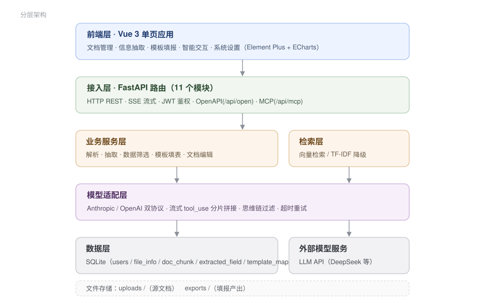

# DocFusion 文档理解与多源数据融合系统

## 技术文档

| 项 | 内容 |
|---|---|
| 作品名称 | DocFusion —— 基于大语言模型的文档理解与多源数据融合系统 |
| 参赛赛事 | 2026 第九届传智杯全国大学生数智创新与 AI 应用大赛 |
| 参赛赛道 | 全国高校 AI Web 开发挑战赛（AI WEB 网页开发挑战赛） |
| 赛题方向 | 方向 4：AI 协同办公工具 —— 智能文档分析平台 |
| 参赛者 | 郑铭创、叶子豪、刘沛嫣 |
| 参赛学校 | 广州软件学院 |
| 参赛组别 | B 组（非 985/211 普通本科院校本科生） |
| 指导教师 | 喻晓雨、翟玲玲 |
| 团队名称 | Blossoms pave your way |
| 文档版本 | v1.2 |
| 更新日期 | 2026-11-01 |

> 对应代码版本：`main` 分支（提交历史见公开仓库）
> 演示视频：见 `docs/` 目录同名文件 ｜ 开源仓库：GitHub（见申报材料清单）

---

## 〇、材料索引

| 材料 | 文件 | 说明 |
|---|---|---|
| 技术文档（本文） | `docs/技术文档.md` / `.pdf` | 按官方七段式组织，≤30 页 |
| 项目概要介绍 | `docs/…-项目概要介绍.pdf` | 11 页，含图 7 幅 |
| 项目详细方案 | `docs/…-项目详细方案.pdf` | 150 页，需求 / 设计 / 测试全量 |
| 项目简介 PPT | `docs/…-项目简介PPT.pptx` | 19 页，答辩用 |
| 演示视频 | `docs/…-项目演示视频.mp4` | 1920×1038 / 30fps |
| 可复现样例 | `samples/` | 合成数据，15 格期望值 |
| 量化实验报告 | `ab_report/final_report.md` | A/B 400 格 + 忠实度校验 |
| AI 协作记录 | `docs/AI协作记录.md` | 真实 Prompt 原文与修正案例 |

---

## 一、项目概述

### 1.1 作品简介

DocFusion 是一个面向基层单位报表填报场景的 AI 协同办公 Web 应用。用户上传若干份源文档（统计公报、
Excel 台账、PDF 附件），再上传一份上报模板，系统自动完成「读懂文档 → 找到数值 → 填进正确的格子 →
保持原样式导出」的全过程，并允许用户用自然语言继续修改结果。

作品形态为 **Vue 3 单页应用**，后端 FastAPI 仅作为 AI 能力与文档处理的接入层，符合本赛项
「以前端 Web 应用为主要呈现形态」的要求。

### 1.2 目标用户

- 需要周期性报送统计表的基层统计 / 办公室人员
- 需要从大量材料中汇总指标的项目申报人员
- 需要把非结构化材料转成结构化数据的分析人员

### 1.3 核心功能

| 功能 | 说明 |
|---|---|
| 文档解析 | 支持 docx / doc / xlsx / xls / md / txt，统一切块入库，xlsx 自动识别真实表头行 |
| 字段抽取 | 规则 + LLM 混合抽取，可从叙述型文本中定位指标数值 |
| 模板识别 | 自动判定「表头批量填」与「字段填空」两种模式，docx 支持多表分别映射 |
| 智能填报 | 列名语义映射 → 数据清洗 → 写回模板，保留原样式；支持求和 / 极值 / 均值列 |
| 图片填充 | Excel 图片占位符自动填图（WPS `DISPIMG` 与浮动图片两种方案） |
| 智能对话 | 自然语言驱动 12 个文档工具，流式输出、步骤可见、可中断 |
| MCP 服务 | 13 个工具经 MCP 协议对外提供，可被其他 Agent 复用 |
| 开放接口 | `/api/openapi/*` 共 9 个端点，供外部系统直接调用抽取能力 |

### 1.4 使用流程

```
登录 → 上传源文档（自动解析切块）
     → 上传模板（自动识别表头/字段）
     → 选择数据源，一键填报
     → 下载结果（原样式） → 对照期望值核验
     → 需要微调时，直接在对话里说「把标题改成黑体加粗」
```

---

## 二、需求分析

### 2.1 业务痛点

基层单位每年要向上报送大量表格：经济指标汇总、环境监测月报、项目申报书……这些表的数据并不缺，
缺的是「把散落在 Word 报告、Excel 台账、PDF 附件里的数字，准确搬到模板对应格子里」的这一步。
现实做法是人工翻文档、Ctrl+F 找数值、复制粘贴，一份 100 行的汇总表往往要两三个人对一整天，
而且错一个数就要整表返工。

难点集中在三处：

1. **口径不一**：同一个指标在不同文档里叫「GDP」「地区生产总值」「GDP 总量」，单位可能是亿元也可能是万元。
2. **载体不一**：数据有的在表格里，有的埋在「上海以 56,708.71 亿元的 GDP 总量稳居全国第一」这种叙述句里。
3. **模板不能动**：上报模板有合并单元格、有固定字体字号，填完不能破坏格式。

### 2.2 功能需求

| 编号 | 需求 | 优先级 |
|---|---|---|
| F1 | 多格式文档上传与自动解析，失败可重试 | 必须 |
| F2 | 从叙事文本中抽取指标数值，不得编造 | 必须 |
| F3 | 自动识别模板结构（表头行 / 填空字段 / 多表） | 必须 |
| F4 | 列名语义映射，低置信度须显式标记「待确认」 | 必须 |
| F5 | 写回模板时保持合并单元格、列宽、字体不变 | 必须 |
| F6 | 支持以自然语言约束填报范围（时间、地区、排序） | 应该 |
| F7 | 对话式修改文档与表格，操作步骤可见 | 应该 |
| F8 | 结果可下载，格式与模板一致 | 必须 |
| F9 | 开放接口 / MCP，可被外部系统与 Agent 调用 | 可选 |

### 2.3 非功能需求

| 维度 | 指标 | 达成情况 |
|---|---|---|
| 准确性 | 逐格准确率 ≥ 99% | 400 格实测 99.75%，唯一分歧经核实为基准错误 |
| 忠实度 | 输出数值 100% 可回查原文 | 400/400 通过 |
| 时延 | 100 行 × 5 列 ≤ 10 秒 | 5.7 秒（5 批并发） |
| 成本 | 单次填报 ≤ 0.1 元 | 约 0.035 元 |
| 可复现 | 同输入同输出 | `temperature=0`，规则与模型职责分离 |
| 安全 | 密钥不入库、不硬编码 | `.env` 注入，仓库历史全量扫描无泄露 |

### 2.4 与现有方案的差异

| 方案 | 做法 | 问题 |
|---|---|---|
| 人工填报 | 人眼找数、复制粘贴 | 慢、易错、不可追溯 |
| 表格生成类工具 | 读模板 → 重建文档 → 写值 | 合并单元格丢失、列宽错乱、印章图片消失 |
| 通用 AI 对话 | 直接把整份文档丢给模型要一张表 | 编造数值、格式全丢、无法核对 |
| **DocFusion** | 复制模板 + 只写目标单元格；规则与 LLM 分工 | 样式保真、数值可溯源、置信度可见 |

---

## 三、系统架构设计

### 3.1 分层架构



前端 Vue 3 单页应用负责全部交互与呈现；后端仅承担 AI 调用编排与文档读写；
模型适配层屏蔽供应商差异，切换模型只改四个配置项。

### 3.2 数据模型（核心表）

| 表 | 作用 |
|---|---|
| `users` | 账号、角色、头像 |
| `file_info` | 上传文件元信息、解析状态 |
| `doc_chunk` | 文档切块（chunk_text / chunk_type / 位置） |
| `extracted_field` | 抽取出的字段与值 |
| `template_info` | 模板元信息与用户要求 |
| `template_mapping` | 字段 ↔ 值 ↔ 来源文件 ↔ 置信度 |
| `task_info` | 解析 / 填报任务状态与产出文件 |
| `chat_session` / `chat_message` | 会话与消息（外键级联删除） |

### 3.3 前端结构

| 层 | 实现 |
|---|---|
| 语言 | 渐进式 TypeScript：`main` / `api` / `router` 为 `.ts`，`views` 与 `components` 仍为 SFC 内 JS；`vue-tsc --noEmit` 覆盖模板类型 |
| 类型层 | `src/api/types.ts` 集中定义与后端 DTO 对齐的接口，接口方法均带泛型返回值 |
| 路由 | `vue-router`，7 个页面全部 `() => import()` 懒加载，天然代码分割 |
| 状态 | 组合式 API + 局部 ref，跨页状态走 localStorage（主题、偏好） |
| 组件 | 12 个单文件组件，`Layout.vue` 承载侧边导航与主题容器 |
| 可视化 | ECharts（工作台统计）、`marked`（对话 Markdown 渲染） |
| 主题 | CSS 变量驱动的 8 套主题，运行时热换肤 |
| 规范 | ESLint 扁平配置（JS + TS + Vue 三套规则）+ Prettier，`npm run verify` 串联类型与 lint |
| 分包 | 按 `element-plus` / `echarts` / `vue` 拆 vendor chunk，入口 chunk 4.4 kB |

### 3.4 接口清单（节选）

| 方法 | 路径 | 说明 |
|---|---|---|
| POST | `/api/auth/login` | 登录（form 表单） |
| POST | `/api/documents/upload` | 批量上传源文档 |
| POST | `/api/documents/{fid}/extract` | 指定字段抽取 |
| POST | `/api/templates/upload` | 上传模板并识别结构 |
| POST | `/api/templates/{tid}/fill` | 执行填报 |
| GET | `/api/templates/history/{task_id}/download` | 下载产出 |
| POST | `/api/chat/ask/stream` | 流式对话（SSE） |
| GET | `/api/mcp/sse` | MCP SSE 通道 |
| GET | `/api/health` | 健康检查 |

---

## 四、AI 技术方案

本章对应评分维度「AI 技术深度（35%）」，逐项说明选型理由、集成方式与优化策略。

### 4.1 模型选型理由

默认 DeepSeek（`deepseek-flash`，Anthropic 兼容端点），理由：

| 维度 | 结论 |
|---|---|
| 抽取准确率 | 400 格中 399 格与基准一致，唯一分歧经核实为基准错误 |
| 忠实度 | 100%（400/400 数值均可在源文档原文找到） |
| 成本 | 约 0.035 元/次（8432 输入 / 6690 输出 token） |
| 兼容性 | 提供 Anthropic 与 OpenAI 两套端点，便于横向对比与降级 |

选型不是「哪个榜单高用哪个」，而是用同一份用例、同一套 Prompt 逐格对比后决定的，
原始数据在 `ab_report/`，可复现。

### 4.2 Prompt 设计与优化策略

**（1）表格抽取**——约束输出结构，禁止解释性文字：

```
从以下文本中提取结构化数据，列名为：["城市", "GDP(亿元)", "增长率(%)", ...]
每行数据对应一个实体（如省份、国家等），返回JSON数组：[{"列名1":"值1",...}]
只返回JSON数组，不要解释。
```

**（2）字段映射**——明确「找不到就留空」，抑制编造：

```
你是表格填写助手。根据模板字段名，从提供的数据和文档片段中找到对应的值来填写。
规则：
1. 如果字段名是一个指标名（如"GDP"、"常住人口"），找到对应的数值
2. 如果字段名是一个文档/政策/标准/书籍标题，从文档中找到关于它的描述作为值
...
5. 如果文档中完全没有提到该字段，设为空字符串
6. 不要编造数据，不要把字段名本身作为值返回
7. 如果用户要求或字段关系涉及加减乘除，允许基于已提取数据做四则运算
8. 四则运算只能使用已给出的数据，除零或缺失数据时返回空字符串
只返回JSON：{"字段名":"值"}
```

**优化策略**：把「不许编造」写成**可执行的规则**（第 5、6、8 条），而不是一句「请准确」。
配合 `temperature=0` 与输出侧忠实度校验，形成「提示词约束 + 参数约束 + 事后校验」三重防线。
第 6 条是实测补上的——初版模型在找不到值时会把字段名本身当答案返回。

### 4.3 Agent 工作流编排

填报任务的执行链路（`routers/templates.py::_fill_table_mode`）：

```
1. 识别模板结构（表头 / 起始行 / 多表）
2. 解析用户要求 → 规则先解析（城市、时间范围、排序、求和）
3. 选源文件：结构化 xlsx 优先，叙事型 docx 走 LLM 抽取
4. 列名语义映射（LLM + 词向量相似度打分，低分走弱匹配兜底并标「待确认」）
5. 数据清洗：脏值（8659! / 6il3）、伪合计行、行政区后缀、重复行
6. 排序 / 求和 / 极值 / 均值
7. 复制模板写入 → 导出
8. 记录映射明细：字段、来源文件、置信度、是否需人工确认
```

对话侧则是标准的多轮工具调用循环：模型输出 `tool_use` → 本地执行 → `tool_result` 回灌 →
继续下一轮，直到模型不再请求工具。每一轮的工具名、入参、耗时都会作为事件推给前端，
用户能看见 Agent 正在做什么。

### 4.4 工具集成与 MCP

对话侧暴露 12 个工具（`services/doc_editor.py::AGENT_TOOLS`）：
`search_documents`、`extract_info`、`list_files`、`edit_document`、`analyze_document`、
`format_document`、`create_spreadsheet`、`format_spreadsheet`、`add_chart`、`validate_spreadsheet`、
`fill_template_smart`、`get_extract_results`。

另有 13 个工具经 **MCP（Model Context Protocol）** 对外暴露：

| 项 | 实现 |
|---|---|
| 协议 | JSON-RPC 2.0，`protocolVersion` 2024-11-05 |
| 通道 | `POST /api/mcp/jsonrpc`（请求响应）+ `GET /api/mcp/sse`（服务端推送） |
| 能力 | `initialize` / `tools/list` / `tools/call` |
| 意义 | 任何支持 MCP 的客户端（Claude Desktop、Cursor 等）都能把本系统当作文档工具集调用 |

工具入参全部使用 JSON Schema 描述，模型侧只拿到 schema，具体执行在本进程内完成，
因此不存在「模型直接操作文件系统」的风险面。

### 4.5 RAG 检索

| 环节 | 实现 |
|---|---|
| 切块 | 按文档结构切分（段落 / 表格 / 标题），保留 `chunk_type` 与位置 |
| 向量化 | `sentence-transformers`（`all-MiniLM-L6-v2`），`normalize_embeddings=True` |
| 检索 | 归一化向量的点积等价余弦相似度，`top_k=5` |
| 字段级检索 | `search_for_fields` 对每个待填字段单独检索 `top_k=3`，避免长文档稀释 |
| 降级 | 无 torch / 无模型时切 TF-IDF + jieba 分词，功能不中断 |
| 隔离 | 按 `user_id` 过滤，不同账号的文档不互相串 |

检索增强在填报链路中的作用是**给模型喂相关片段而不是整篇文档**——既降 token 成本，
也减少长上下文下的数值串行错误。

### 4.6 多模态能力

| 能力 | 实现 |
|---|---|
| 图片理解 | 前端上传图片 → base64 → 以 `image` content block 传给模型（同时兼容 Anthropic 与 OpenAI 两种图片格式） |
| 图片填充 | Excel 模板中的图片占位符自动填图，兼容 WPS `DISPIMG` 函数与浮动图片两种方案 |
| 图文混排 | 对话中可同时挂载文档与图片，模型在同一次请求中理解两者 |

### 4.7 AI 安全与可控性

这一项在评分中占 4%，本项目的做法是「不指望模型不出错，而是让错误可被发现」：

| 机制 | 作用 |
|---|---|
| `temperature=0` | 同输入同输出，结果可复现 |
| 强制 JSON + 解析失败兜底 | 模型返回非 JSON 时不抛错，降级为原文回显 |
| 忠实度校验 | `scripts/faithfulness_check.py` 把每个数值回查源文档原文，检测编造 |
| 置信度与「待确认」 | 低置信度映射不硬填，标记待人工确认，置信度封顶 0.65 |
| 值等于字段名过滤 | 模型把字段名当答案返回时直接丢弃 |
| 思维链过滤 | `<think>` 标签跨包切分时缓存半截标签，避免思考内容泄漏到回答 |
| 工具白名单 | 模型只能调用已注册的 12 / 13 个工具，无文件系统直通 |
| 密钥管理 | `.env` 注入，仓库历史全量扫描无硬编码密钥 |

### 4.8 流式输出协议

`POST /api/chat/ask/stream` 采用 SSE，事件序列固定：

```
session  →  delta / tool_start / tool_end  →  done
（异常统一走 error，前端不会挂起）
```

仅在尚未产出任何文本前允许重试，避免已推送内容重复。

### 4.9 降级策略

| 环节 | 主路径 | 降级 |
|---|---|---|
| 向量检索 | sentence-transformers | TF-IDF + jieba 分词 |
| 列名映射 | LLM 语义映射 | 词向量相似度打分 + 弱匹配兜底（置信度封顶 0.65，标记待确认） |
| 模型调用 | 流式 | 非流式；HTTP 502/503/504 与超时自动重试 3 次 |
| `.doc` 解析 | LibreOffice 转换 | 提示安装，不影响其他格式 |

---

## 五、核心功能实现

### 5.1 样式保真填充，而不是「生成一张新表」

多数同类方案是读模板 → 重建文档 → 写入数据，结果是合并单元格丢失、列宽错乱、印章图片消失。
本项目采用「复制模板文件 + 只写目标单元格」的策略，写入前后除目标单元格外字节级不变，
Word 的表格样式、Excel 的合并区与图片锚点全部保留。

### 5.2 规则与 LLM 的分工边界

LLM 只负责两件它真正擅长的事：**语义映射**（模板列名 ↔ 源文档列名）与**叙述文本抽取**。
数值归一化（千分位、全角、单位换算）、去重、伪合计行剔除、行政区后缀归一化全部走确定性规则。
好处是成本可控（单次填报约 0.035 元）、结果可复现（`temperature=0`）、出错可定位。

### 5.3 双协议模型适配层

同一套业务代码可跑在 Anthropic 与 OpenAI 两种协议上，切换供应商只改四个配置项。
这层适配解决了三个真实兼容性坑：流式 tool_use 的 JSON 分片拼接、思维链标签跨包切分、
思考模式与 `temperature` 冲突。

### 5.4 关键代码

**（1）模型适配：一处分发，两种协议**

```python
async def call_llm(messages, system="", temperature=0.1, max_tokens=4096, tools=None):
    if cfg.LLM_API_FORMAT == "anthropic":
        return await _call_anthropic(messages, system, temperature, max_tokens, tools)
    return await _call_openai(messages, system, temperature, max_tokens, tools)
```

**（2）流式 tool_use 的 JSON 分片拼接**（Anthropic 按 `partial_json` 增量下发）

```python
elif et == "content_block_delta":
    delta = ev.get("delta") or {}
    if delta.get("type") == "input_json_delta" and idx in blocks:
        blocks[idx]["json"] += delta.get("partial_json", "")
```

**（3）思维链过滤**：`<think>` 标签可能被切到两个 delta，需要缓存半截标签

```python
class _ThinkFilter:
    def feed(self, delta: str) -> str:
        self._buf += delta
        # 找到 <think> 就丢弃到 </think>；结尾可能是半个标签，留到下一包
        ...
```

**（4）样式保真写入**：只写单元格值，不动样式

```python
for r_i, row in enumerate(rows, start=start_row):
    for c_i, col in enumerate(columns, start=1):
        ws.cell(row=r_i, column=c_i).value = row.get(col_name)
```

### 5.5 性能与成本

| 项 | 数值 |
|---|---|
| 单次填报（100 行 × 5 列） | 5.7 秒（5 批并发，每批 ≤15000 字符） |
| 单次填报成本 | 约 0.035 元 |
| 样例填报（3 行 × 5 列） | 约 2.5 秒 |
| 前端首屏 | 路由级懒加载，按页面分包 |
| 检索降级 | 无 GPU / 无 torch 时自动 TF-IDF，功能不中断 |

---

## 六、界面与截图

以下截图均为系统实际运行界面（1440×900 视口，2× 像素密度采集）。

**图 6-1　工作台：数据总览与任务监控**
文档总数、已解析数、抽取字段数、模板数、平均用时与成功率一屏可见，下方为功能模块入口与文件类型分布。


**图 6-2　文档管理：多格式上传与解析状态**
支持 docx / xlsx / md / txt 批量上传，列表直接展示解析状态、切块数、抽取字段数与耗时，可单条重解析或批量抽取。


**图 6-3　信息抽取：多源融合结果与置信度**
同一字段在 36 个文件中有多个候选值，融合视图给出融合值、置信度、最佳来源与候选数，右侧浮层可展开全部候选及来源权重。


**图 6-4　模板填报：映射明细与置信度说明**
左侧上传模板与数据源，右侧实时展示总字段、已填写、准确率、耗时与数据行；每一格都可追溯来源与置信度构成（重名匹配 25%、数据源匹配 25%、数据类型一致性 20%、非空填充率 15%、同列格式一致性 10%、取值合理性 5%）。


**图 6-5　用户要求：以自然语言约束填报范围**
「把 2020/7/1 到 2020/8/31 的数据填入模板，城市：德州市」这类要求可直接输入，系统解析为筛选条件后再执行填报。


**图 6-6　填报产出：原样式写回的结果表**
写入后合并单元格、列宽、字体字号与原模板一致，仅目标单元格被赋值，可直接用于报送。


**图 6-7　智能交互：多文件上下文与任务执行**
会话内可勾选多份文档作为上下文，输入框上方显示已挂载文件；左侧为历史会话，支持多会话并行。


**图 6-8　系统设置：账号、模型配置与操作日志**
同一页面下分「个人资料 / 模型配置 / 用户管理 / 操作日志」四个页签，模型配置支持热切换 API Base、Key、模型名与协议格式，无需重启。


**图 6-9　个性化中心：主题预设与自定义**
内置 8 套主题（含暗色），支持自定义主题色与编辑器热换肤，偏好写入 localStorage。


---

## 七、测试与部署

### 7.1 部署方式

- 开发模式：后端 `python main.py`（:8000）+ 前端 `npm run dev`（:3000，Vite 代理 `/api`）
- 单端口模式：`npm run build` 后启动后端，由 FastAPI 托管 `frontend/dist` 并回落 history 路由，
  演示与部署不再需要额外 Nginx
- 一键启动：`scripts/start_dev.ps1` 自动建 venv、装依赖、生成 `.env`、起服务
- 详细步骤见仓库根目录 `README.md`

### 7.2 模型通道测试（2026-10-31）

| 路径 | 结果 |
|---|---|
| 非流式文本 / tools / 多轮 tool_result | ✅ |
| 流式文本 / tools / 多轮 tool_result | ✅ |
| JSON 结构化抽取 | ✅ |
| 图片理解（多模态） | ✅ |

### 7.3 端到端样例（`samples/` 合成数据）

| 用例 | 结果 |
|---|---|
| 上传 docx 叙事公报 + xlsx 数据源 → 解析 | ✅ 4 / 2 个切块，数值完整 |
| xlsx 模板填报 | ✅ 3 行 × 5 列 = 15 格全部正确，accuracy 1.0，2.6 秒 |
| docx 模板填报 | ✅ 15 格全部正确，accuracy 1.0 |
| 流式对话（读真实文档作答） | ✅ SSE 逐字输出，正确识别 2 份已上传文档 |
| 单端口静态托管 + history 路由回落 | ✅ `/`、`/dashboard`、`/assets/*` 均正常，`/api/*` 不存在时返回 404 |

### 7.4 抽取层 A/B（100 行 × 5 列 = 400 格）

详见 `ab_report/final_report.md`。核心结论：逐格一致率 99.75%，唯一分歧经核实为基准错误，
修正后 400/400；忠实度 100%。

### 7.5 在线演示

支持单端口部署，`python main.py` 即可对外提供完整应用；如需公网访问，
后端托管静态产物后可挂任意反向代理或容器平台。评审如需体验账号，另行提供。

---

## 八、创新点

### 8.1 技术创新点

1. **样式保真的「复制 + 定点写入」策略**：不做文档重建，只改目标单元格，合并单元格、列宽、
   图片锚点字节级保留——这是与「AI 生成表格」类方案的本质区别。
2. **规则与 LLM 的职责切分**：LLM 只做语义映射与叙事抽取，数值归一化、去重、伪合计剔除全部
   走确定性规则。结果是成本可控、结果可复现、出错可定位。
3. **双协议模型适配层**：同一套业务代码跑在 Anthropic / OpenAI 两种协议上，并解决了流式
   `tool_use` JSON 分片、思维链标签跨包切分、思考模式与 temperature 冲突三个真实兼容坑。
4. **可量化的效果验证体系**：内置 A/B 逐格对比与忠实度回查脚本，把「效果好不好」变成可复现的数字，
   而不是主观描述。
5. **MCP + OpenAPI 双通道输出能力**：系统本身既是应用，也是可被其他 Agent 调用的工具集。

### 8.2 应用创新点

1. **把「填报」而非「生成」作为核心场景**：真实政务 / 企业报表有固定模板与固定格式，
   用户要的是填进去，不是重新生成一份。
2. **置信度可见、可疑值可追溯**：每一格都能点开看候选值、来源文件与权重构成，
   把 AI 的黑箱变成可审计的白箱——这是办公场景能否被信任的关键。
3. **对话即操作**：用户不必学新界面，直接在对话框里说「标题改黑体加粗，正文宋体小四」，
   Agent 自己调用工具完成，且步骤全程可见、可中断。
4. **自然语言约束填报范围**：「把 7 月到 8 月、德州市的数据填进去」这类口语化要求，
   直接变成筛选条件，省掉一层表单配置。
5. **零依赖降级**：没有 GPU、没有向量模型的环境下自动切 TF-IDF，基层单位的老机器也能跑。

---

## 九、总结与展望

### 9.1 总结

本项目从一个非常具体的痛点出发——「把散落各处的数字准确搬进上报模板」——把大模型用在它真正
擅长的地方（读懂叙事文本、理解列名语义），把不适合交给模型的部分（数值归一、格式保真、去重）
交还给确定性代码。最终交付的是一个可运行、可复现、可审计的 Web 应用：
400 格实测 99.75% 逐格一致、100% 忠实度、0.035 元一次、5.7 秒完成。

### 9.2 局限

1. **并发**：SQLite 单机写入，未做高并发压测；下一步换 PostgreSQL + 任务队列。
2. **扫描件**：暂不支持 OCR，扫描版 PDF 需先转文本。
3. **模板泛化**：表头识别基于启发式，极端非标准模板仍需人工指定映射。
4. **权限**：内测阶段统一为 admin，正式版按角色收口（代码中已显式标注位置）。
5. **评测集**：当前用例规模有限（400 格），计划扩充到多行业、多语种模板。

### 9.3 展望

- 模板库与相似模板复用，把「一次识别」变成「越用越准」
- 接入 OCR，打通扫描件与图片型 PDF
- 视图层继续补齐 TypeScript 类型，并补组件测试（当前仅有 `verify_llm.py` 的接口级健康检查）
- 支持多人协同填报与审批流，向完整的办公协同平台演进

---

## 十、优化说明

本项目在下列开源能力之上自行设计并实现业务层，未直接套用现成开源项目：

| 依赖 | 用途 | 自研部分 |
|---|---|---|
| FastAPI / SQLAlchemy | Web 框架与 ORM | 全部路由、服务、数据模型 |
| python-docx / openpyxl | 文档读写 | 模板结构识别、样式保真填充、DISPIMG 图片方案 |
| sentence-transformers | 文本向量 | 检索策略、TF-IDF 降级、字段级检索 |
| Element Plus / ECharts | UI 组件 | 全部页面与交互 |
| Vue 3 / vue-router | 前端框架 | 路由懒加载、主题引擎、流式渲染 |

模型侧不依赖任何闭源 SDK，直接以 HTTP 调用兼容接口，因此可自由切换供应商。

---

## 附录 A：环境变量

| 变量 | 默认值 | 说明 |
|---|---|---|
| `DATABASE_URL` | `sqlite:///./app.db` | 数据库连接串 |
| `LLM_API_BASE` | `https://api.deepseek.com/anthropic` | 模型端点 |
| `LLM_API_KEY` | 空 | 密钥（勿入库） |
| `LLM_MODEL` | `deepseek-flash` | 模型名 |
| `LLM_API_FORMAT` | `anthropic` | `anthropic` / `openai` |
| `LLM_DISABLE_THINKING` | `true` | 关闭思考模式（DeepSeek 专用） |
| `EMBEDDING_MODEL` | `all-MiniLM-L6-v2` | 向量模型 |
| `SECRET_KEY` | 随机 | JWT 密钥，生产必须固定 |
| `MCP_ENABLED` | `true` | MCP 服务开关 |
